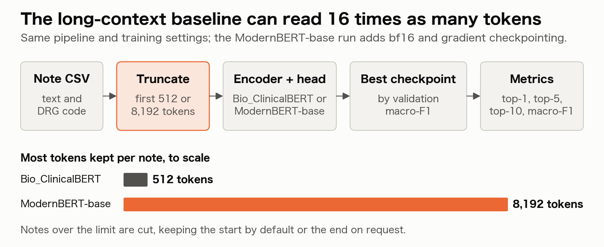
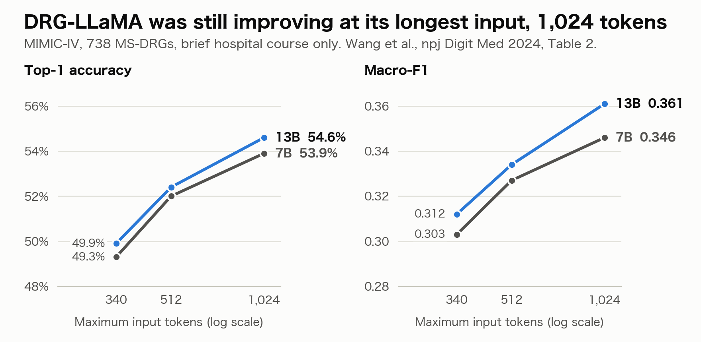

# MS-DRG Classification from Discharge Summaries

[](https://github.com/ayazkhan-pathan/MS-DRG-Classification/actions/workflows/ci.yml) [](LICENSE)

An admission's Medicare Severity Diagnosis-Related Group (MS-DRG) sets what Medicare pays the hospital for the stay. Can a model that reads the whole discharge summary predict it better than one that reads a single section? DRG-LLaMA, the benchmark to beat, read only the brief hospital course and reached 54.6% top-1 accuracy over 738 MS-DRGs on MIMIC-IV [1]. This repository holds two tested baselines: Bio_ClinicalBERT, which reads the first 512 tokens of each note, and ModernBERT-base, which reads up to 8,192 and will be the first to test the question. A chunked method with no length limit is [not yet released](#methods-not-yet-released), and no MIMIC-IV data or results are stored here.

<p align="center"></p>
<p align="center"><sub><i>The two released baselines. Drawn by scripts/make_diagrams.py.</i></sub></p>

## Why read the whole note

- **Full notes are long, and a 512-token cut was blamed for weak ICD coding.** In one MIMIC-IV ICD-10 cohort, 99.7% of discharge summaries were longer than 512 tokens [2]. On the 50 most frequent codes, Bio_ClinicalBERT cut to 512 tokens reached a micro-F1 of 0.465, below TF-IDF at 0.553; the authors put this down to the 512-token limit. Length itself need not hurt: for MIMIC-IV notes of 1,000 to 4,000 words, length and ICD-coding micro-F1 were barely correlated (Pearson r from −0.02 to −0.09 across six models) [3].
- **The strongest DRG models read one section.** To fit LLaMA's input limit, DRG-LLaMA kept only the brief hospital course, which averages 398 words [1]. DRG-Sapphire, a reasoning LLM trained and tested on DRG-LLaMA's splits, used the same section [4]. Whether the other sections help a model trained on DRG labels appears untested; a long-context encoder such as ModernBERT can test it.
- **The only whole-note DRG study found so far never trained on DRG labels.** OCSF (ontology-compiled clinical state fields) read notes of up to 3,072 tokens in one unchunked pass and reached under 10% top-1, on a larger set of DRG labels than DRG-LLaMA's [5].

<p align="center"></p>
<p align="center"><sub><i>DRG-LLaMA's Table 2 [1]. Drawn by scripts/make_diagrams.py.</i></sub></p>

## The numbers to beat

DRG-LLaMA on MIMIC-IV with MS-DRG v34: 236,192 training and 26,244 test admissions, 738 MS-DRGs in the training set, brief hospital course as input [1]. The LLaMA rows are its Table 2 at 1,024 tokens. The last row is its Table 1 ClinicalBERT baseline: Bio_ClinicalBERT [6] with the same settings as this repository's default, but fed the brief hospital course. `drg train` reads the start of whatever text column it is given; [MIMIC-IV access](#mimic-iv-access) says what a like-for-like comparison needs.

| Model | Max tokens | Top-1 | Top-5 | Top-10 | Macro-F1 |
|:---|---:|---:|---:|---:|---:|
| DRG-LLaMA 13B | 1,024 | **54.6%** | **86.5%** | **92.5%** | **0.361** |
| DRG-LLaMA 7B | 1,024 | 53.9% | 86.1% | 92.3% | 0.346 |
| Bio_ClinicalBERT | 512 | 50.2% | 81.5% | 88.1% | 0.233 |

DRG-Sapphire [4] is not in the table: it reached 54.8% Pass@1, 0.2 points above DRG-LLaMA 13B and within that model's bootstrap standard deviation of 0.3 points, and it reports no top-5, top-10 or macro-F1.

## Released code: two encoder baselines

`drg train` fine-tunes an encoder with a linear DRG head, cuts each note to `--max-length` tokens and keeps the checkpoint with the best validation macro-F1. `drg evaluate` reports top-1, top-5, top-10 and macro-F1 as DRG-LLaMA's evaluation code computes them (without its AUC), and `drg predict` writes the most likely DRGs per note. The package's 52 tests, run in CI on synthetic notes, cover train, evaluate and predict end to end with tiny random BERT and ModernBERT models (ModernBERT at 1,024 tokens).

Both baselines use the settings of DRG-LLaMA's `clinicalBERT_single.py` ([hanyin88/DRG-LLaMA](https://github.com/hanyin88/DRG-LLaMA)): batch 16, learning rate 2e-5, weight decay 0.01 and 3 epochs. These are also the settings of this repository's first ModernBERT script, `basic_tune.py` (in the git history).

- **Bio_ClinicalBERT [6], the default,** reads the first 512 tokens of each note.
- **ModernBERT-base [7]** reads up to 8,192 tokens as one sequence, with no chunking. Choose it with `--model` and `--max-length` (see [Run it](#run-it)); `--bf16` and `--gradient-checkpointing` help it fit in GPU memory.

<details>
<summary>How the package differs from <code>clinicalBERT_single.py</code> and <code>basic_tune.py</code></summary>

- **Both scripts:** labels here are DRG codes, not prepared class ids, and the best checkpoint is chosen by validation macro-F1 (`clinicalBERT_single.py` kept the lowest loss, `basic_tune.py` the best accuracy).
- **`clinicalBERT_single.py`:** no `paths.json` is needed; every row is used unless `--subsample` or `--eval-subsample` is given; W&B is off unless `--wandb` is given (install the `wandb` extra); the metrics are tested against scikit-learn.
- **`basic_tune.py`:** data paths are options; validation reads its own CSV, not a third of the test CSV; mixed precision is optional (`--fp16` or `--bf16`), not always on.

</details>

## Methods not yet released

- **Chunk-based training.** Long discharge summaries are split into overlapping, sentence-based chunks, and the model is trained on the chunks.
- **Chunk-logit aggregation.** Each chunk's logits are normalised, then aggregated into one DRG per admission (figure below).
- **Summarise first.** Each note is summarised before classification. With MIMIC-IV notes the summariser must run locally or on a service that complies with the PhysioNet data use agreement.
- **MLP classification heads on LLaMA 3.** Small multilayer-perceptron heads predict the DRG from LLaMA 3's representations.

<p align="center"></p>
<p align="center"><sub><i>The chunked method. Drawn by scripts/make_diagrams.py.</i></sub></p>

## Run it

Needs Python 3.9 or later, PyTorch 2.6 or later and Transformers 4.48 or a later 4.x release.

```bash
git clone https://github.com/ayazkhan-pathan/MS-DRG-Classification.git
cd MS-DRG-Classification
python -m pip install --upgrade pip
python -m pip install -e ".[dev]"
```

**Smoke run on synthetic notes** (invented words labelled S01 to S04, from `src/drg/synthetic.py`), under a minute on a laptop CPU:

```bash
python scripts/make_synthetic_data.py --out-dir data/synthetic
drg train --train-csv data/synthetic/train.csv --eval-csv data/synthetic/val.csv \
  --model hf-internal-testing/tiny-random-BertForSequenceClassification \
  --output-dir runs/smoke --epochs 2 --cpu
drg evaluate --model-dir runs/smoke --csv data/synthetic/test.csv
drg predict --model-dir runs/smoke --csv data/synthetic/test.csv \
  --output runs/smoke/predictions.csv
# For the ModernBERT path, train with
#   --model hf-internal-testing/tiny-random-ModernBertForSequenceClassification
```

Expect chance-level scores (top-1 about 0.25) from the tiny random models.

**MIMIC-IV run**, with credentialed access and the CSVs built as described in [MIMIC-IV access](#mimic-iv-access):

```bash
drg train --train-csv data/mimic/train.csv --eval-csv data/mimic/val.csv \
  --label-column drg --output-dir runs/bioclinicalbert-512
drg train --train-csv data/mimic/train.csv --eval-csv data/mimic/val.csv \
  --label-column drg --model answerdotai/ModernBERT-base --max-length 8192 \
  --bf16 --gradient-checkpointing --output-dir runs/modernbert-8192
drg evaluate --model-dir runs/modernbert-8192 --csv data/mimic/test.csv \
  --output runs/modernbert-8192/test_metrics.json
```

If a long batch does not fit in memory, lower `--batch-size` and raise `--gradient-accumulation-steps` to keep 16 notes per update. Never pass the test CSV as `--eval-csv`: the checkpoint is chosen on it.

- `drg train --help` lists every option with its default.
- `python scripts/make_diagrams.py` redraws the figures in `docs/images/` (it needs the `figures` extra).
- `pytest`, `ruff check .` and `ruff format --check .` are the checks CI runs.

## Layout

```
MS-DRG-Classification/
├── src/drg/
│   ├── cli.py          drg train | evaluate | predict
│   ├── data.py         note CSVs, label map, batching
│   ├── metrics.py      top-1, top-5, top-10, macro-F1
│   ├── train.py        fine-tuning with the Hugging Face Trainer
│   ├── predict.py      evaluation and prediction
│   └── synthetic.py    synthetic notes for tests and smoke runs
├── scripts/            make_synthetic_data.py, make_diagrams.py
├── tests/              pytest suite
├── docs/images/        figures
├── .github/            CI on Python 3.9 and 3.12, with the tested versions pinned
├── pyproject.toml
└── LICENSE
```

## Data format

- One row per admission, with the note in `text` and the DRG code in `label` (or set `--text-column` and `--label-column`). Codes are read as strings.
- The label map comes from the training codes and is saved with the model.
- A note whose DRG is not in the training set is left out of model selection, with a warning, and counts as an error in `drg evaluate`.
- Macro-F1 averages per-DRG F1 over the DRGs in the labels, as DRG-LLaMA does; predicting a DRG absent from the labels still counts as a miss for the true one.

## MIMIC-IV access

MIMIC-IV and MIMIC-IV-Note are on PhysioNet; access needs credentialing, a training course and a signed data use agreement. To build the CSVs in `data/mimic/`:

1. Read `note/discharge.csv.gz` (MIMIC-IV-Note), keeping `subject_id`, `hadm_id` and `text`.
2. Keep `hosp/drgcodes` rows with `drg_type` = 'HCFA', which are MS-DRGs, and drop admissions with more than one distinct HCFA code.
3. Join on `hadm_id` and write `text`, `drg` (from `drg_code`), `hadm_id` and `subject_id`, plus a `bhc` column holding the text under the note's "Brief Hospital Course:" heading, up to the next heading (usually "Medications on Admission:"). DRG-LLaMA cut this section out with regular expressions [1].
4. Split 80/10/10 into `train.csv`, `val.csv` and `test.csv` by `subject_id` with a fixed seed (for example scikit-learn's `GroupShuffleSplit`), so no patient is in two splits.

Training with `--text-column bhc` matches DRG-LLaMA's input, but DRG-LLaMA also mapped codes to MS-DRG v34 and used its own splits (its preprocessing is not reproduced here), so scores from these steps are not directly comparable with the table above. Because `data/` and `runs/` are git-ignored, MIMIC-IV data, per-note outputs and fine-tuned weights stay out of commits. A run folder also records the paths it was given, so share only its metrics files.

## Limitations

- There are no MIMIC-IV results yet. Synthetic runs show that the code works end to end, not that either model predicts DRGs well.
- Bio_ClinicalBERT sees only the start of most full notes (or the end, with `--truncation-side left`). ModernBERT-base cuts notes past 8,192 tokens the same way; how many MIMIC-IV notes fit is not measured here.
- Text may not settle the DRG on its own: the grouper also uses age, sex, discharge disposition and other structured fields [5].

## Roadmap

- [x] Release the Bio_ClinicalBERT and ModernBERT-base baselines as a tested package
- [ ] Score ModernBERT-base on MIMIC-IV twice, on the brief hospital course and on the full note up to 8,192 tokens (reporting how many notes fit), to answer the opening question with the encoder held fixed
- [ ] Score Bio_ClinicalBERT on the brief hospital course and set it beside DRG-LLaMA's Table 1 baseline
- [ ] Release the four methods under [Methods not yet released](#methods-not-yet-released) and set their scores beside DRG-LLaMA's Table 2

## References

1. Wang H, Gao C, Dantona C, Hull B, Sun J. DRG-LLaMA: tuning LLaMA model to predict diagnosis-related group for hospitalized patients. *npj Digit Med* 2024;7:16. [doi:10.1038/s41746-023-00989-3](https://doi.org/10.1038/s41746-023-00989-3)
2. Chen M-I, Hsu Y-L, Chen Y-H. Revenue-sensitive evaluation of AI-assisted ICD-10-CM coding and human-AI collaboration under dual DRG payment systems. *Sci Rep* 2026;16:26729. [doi:10.1038/s41598-026-57682-0](https://doi.org/10.1038/s41598-026-57682-0)
3. Edin J, Junge A, Havtorn JD, Borgholt L, Maistro M, Ruotsalo T, Maaløe L. Automated medical coding on MIMIC-III and MIMIC-IV: a critical review and replicability study. *SIGIR* 2023:2572–2582. [doi:10.1145/3539618.3591918](https://doi.org/10.1145/3539618.3591918)
4. Wang H, Wu Z, Kolar G, Korsapati H, Bartlett B, Hull B, Sun J. Reinforcement learning for out-of-distribution reasoning in LLMs: an empirical study on diagnosis-related group coding (DRG-Sapphire). *arXiv* 2025. [arXiv:2505.21908](https://arxiv.org/abs/2505.21908)
5. Wang Z. Ontology-compiled 2D clinical state fields with bidirectional diffusion encoders for zero-training cross-ontology medical coding (OCSF). *arXiv* 2026. [arXiv:2611.30218](https://arxiv.org/abs/2611.30218)
6. Alsentzer E, Murphy J, Boag W, Weng W-H, Jindi D, Naumann T, McDermott M. Publicly available clinical BERT embeddings. *ClinicalNLP Workshop* 2019:72–78. [doi:10.18653/v1/W19-1909](https://doi.org/10.18653/v1/W19-1909)
7. Warner B, Chaffin A, Clavié B, Weller O, Hallström O, Taghadouini S, Gallagher A, Biswas R, Ladhak F, Aarsen T, Cooper N, Adams G, Howard J, Poli I. Smarter, better, faster, longer: a modern bidirectional encoder for fast, memory efficient, and long context finetuning and inference (ModernBERT). *arXiv* 2024. [arXiv:2412.13663](https://arxiv.org/abs/2412.13663)

## Licence

The code is under the MIT licence; see [LICENSE](LICENSE). MIMIC-IV data are under PhysioNet's credentialed licence and are not included. The repository contains no DRG-LLaMA code.
